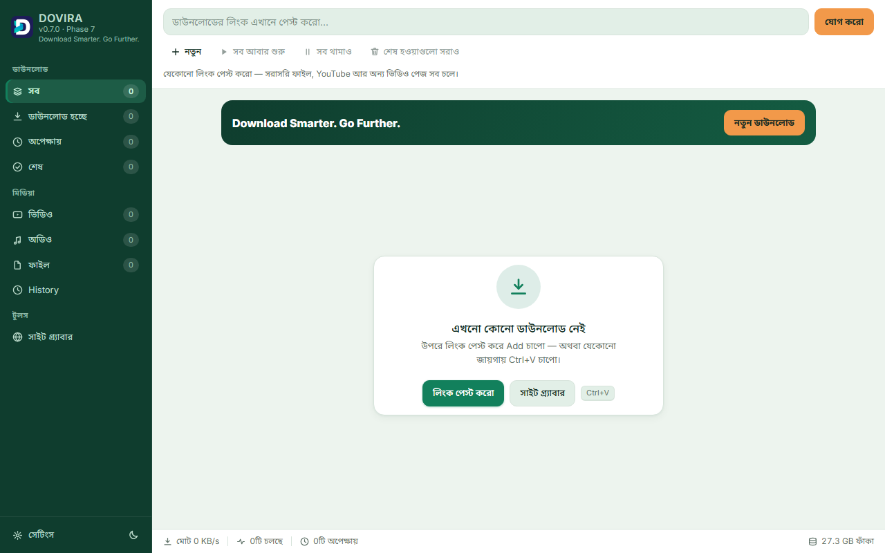
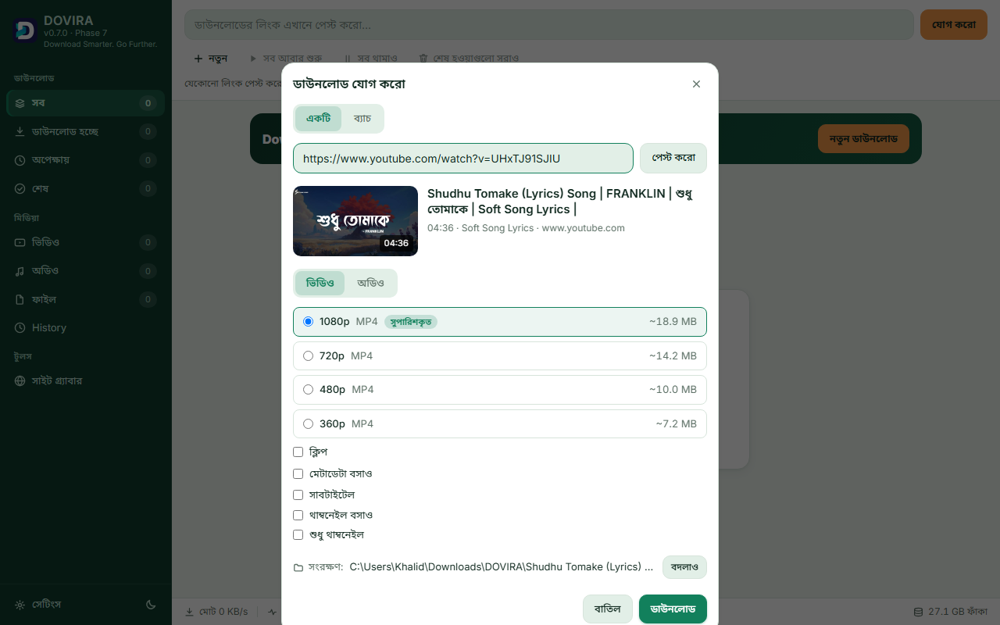
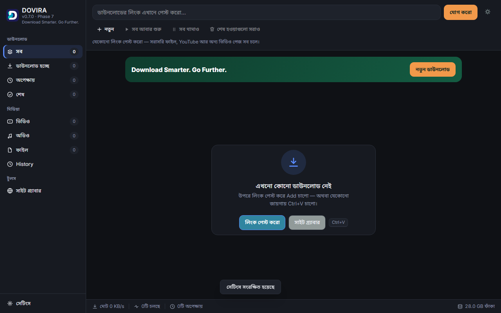

# DOVIRA

> **Download Smarter. Go Further.**

DOVIRA is a free, open-source AI download manager for Windows, macOS and Linux — download videos and audio from the web with quality choice, smart resume, and rule-based smart features. No ads, no tracking, no pro-lock.

## Status

**v1.2.0 — Phases 0–7 + guided setup (done).** Everything in the master plan through v1.2 is built, tested and released: aria2 downloads with pause/resume/cancel/retry, queue (max 3 concurrent), SQLite history with migrations, disk-space checks, Settings, EN/BN interface, dark + light themes (Mint light is the default), Windows completion notifications, yt-dlp video/audio downloads with quality choice, Add Download Dialog with real format list + sizes, subtitles + thumbnail embed options, per-engine version info and yt-dlp one-click update (backup + smoke test + rollback), plain-language error messages, yt-dlp resume with the same format only (never a silent restart), History page, cookies support, scheduler and tray, playlist/channel download, batch download, clip download, metadata + subtitle options, thumbnail-only download, torrent/magnet support, browser extension with a token-authenticated Local API, site grabber + speed limiter, macOS/Linux installers + auto-update with mandatory checksum verification, and the Phase 7 Smart features below.

## Screenshots







## Install

Get the installer for your OS from the [Releases page](https://github.com/Khalid635/dovira/releases) (every release is a pre-release, with a SHA-256 checksum file — `checksums.txt` — next to the installers).

- **Windows:** `dovira-<version>-setup.exe` (NSIS installer).
- **macOS:** `dovira-<version>.dmg` (Intel x86_64; Apple Silicon runs it through Rosetta 2). The dmg is **unsigned** (no paid Apple Developer account), so Gatekeeper blocks the first launch: **right-click the app and choose Open** (or run `xattr -d com.apple.quarantine /Applications/dovira.app` in Terminal) — then it opens normally.
- **Linux:** `dovira-<version>.AppImage` (run it directly, `chmod +x` first) or `dovira_<version>_amd64.deb` (`sudo dpkg -i`).

**Auto-update:** the app checks GitHub Releases for a newer version (Settings > App updates; on by default, download is manual by default). Every downloaded update's SHA-256 is verified against the release's `checksums.txt` **before** it is installed — on a mismatch the update is cancelled, the old version keeps running, and Settings says why.

**aria2 on macOS/Linux:** aria2 publishes no prebuilt binary for these platforms, so it is built from source in CI (`scripts/build-aria2.sh`). If a release ships without it, plain files still download (through yt-dlp) — only torrents/magnets need aria2 and will report "engine missing".

## Features

- **Direct file downloads** — multi-connection via aria2, pause/resume that survives app restarts (network drop, app restart, PC reboot). yt-dlp resume always reuses the exact same format; if the partial file is gone, the app says so instead of silently restarting
- **Video & audio downloads** — YouTube and other video sites via yt-dlp: pick Video quality (up to 2160p) or Audio MP3, subtitles and thumbnail included on request
- **Smart Resume** — interrupted downloads resume where they stopped
- **Queue** — max 3 simultaneous downloads, the rest wait their turn
- **History** — every download is stored in local SQLite and survives restarts
- **Playlists & batch** — download a whole playlist/channel (pick the entries, one quality for all) or paste many links at once; already-downloaded videos can be skipped via the download archive
- **Clips, metadata & subtitles** — download just a time range of a video, embed title/artist metadata and thumbnails, or save subtitles as .srt (including auto-generated captions)
- **Torrents** — magnet links and .torrent files via aria2 (DHT on, never seeds after a download finishes)
- **Browser extension** — right-click "Download with DOVIRA", toolbar popup, floating download button on video pages, optional download intercept (off by default). Pairs with the app over a token-authenticated Local API on 127.0.0.1 — guided install, live status and diagnostics are in the app (Settings > Setup & diagnostics). See `extension/README.md` — Firefox (AMO) first; Chrome via Load unpacked. Do NOT submit the YouTube-download capability to the Chrome Web Store (its policy prohibits it).
- **Site grabber** — scan a page for downloadable files (images, documents, media) and queue the ones you pick
- **Speed limiter** — a global cap plus a per-download cap, applied live to running downloads. A changed limit takes effect on the next _fresh_ yt-dlp download, not a resumed fragmented one (yt-dlp keeps the original throttle on resume); aria2 resumes apply the new limit immediately
- **Smart features (v1.0, Settings > Smart — every feature has its own switch)**
  - **AI File Organizer** — downloads are sorted into Video, Music, Documents, Archives, Programs, Images or Others, from the file extension, yt-dlp metadata (category, duration) and the source domain. Folder names are editable; extension overrides are yours to set
  - **Smart filenames** — strips `(Official Video)`, `[HD]`, emoji and extra spaces from titles, then applies your template (default `{title} [{height}p]`). The Add dialog shows a preview with a one-click revert
  - **Duplicate Detection** — checks the history for the same URL or the same video + format, and the destination folder for the same name + size. If found, the dialog offers Re-download / Skip / Keep both
  - **Smart Download** — measures your running speed and adapts: more aria2 connections and yt-dlp fragments when fast and stable, fewer (and longer retry gaps) when slow or unstable
  - **Local AI model (optional, off by default)** — for the downloads the rules cannot categorize, an Ollama or LM Studio model running on your machine can be asked instead. No model is bundled; nothing leaves your machine
- **AI Assistant** — done in v1.1.0 (optional local model, off by default)

Engines: aria2, yt-dlp, ffmpeg and Deno (all bundled).

## Limitations (v1.2.0)

- Login-only videos need cookies — set them in Settings > Browser & Cookies (the app says so instead of failing silently).
- DRM-protected sites (Netflix, Prime Video, Disney+) can never be supported.
- The browser extension UI is English-only for now; the app itself is EN/BN.
- Playlist links sent from the extension are refused — pick entries in the app's Add dialog.
- Video quality shown comes only from the site's real format list — if a video has no 1080p, 1080p is not offered.
- The macOS dmg is unsigned — first launch needs right-click > Open (see Install).
- On macOS/Linux without a bundled aria2, torrents/magnets are unavailable (plain files still work via yt-dlp).
- A changed speed limit or fragment count takes effect on the next _fresh_ yt-dlp download, not on a resumed fragmented one (see Speed limiter above).
- The "Total size" stat counts the video stream size yt-dlp reports, which can differ from the final file size on disk.

## Build & run

```bash
npm install
npm run fetch-binaries   # downloads aria2, yt-dlp, ffmpeg, deno into resources/bin/win (git-ignored)
npm run fetch-binaries -- --platform mac    # macOS binaries (yt-dlp, ffmpeg, deno; aria2 needs scripts/build-aria2.sh)
npm run fetch-binaries -- --platform linux  # Linux binaries (same note)
npm run dev              # dev shell (Electron + Vite)
npm run build            # extension build + typecheck + production build
npm run build:extension  # browser extension only (TypeScript -> extension/dist)
npm run build:win        # Windows installer (NSIS)
npm run build:mac        # macOS dmg (unsigned — needs a Mac or GitHub Actions)
npm run build:linux      # Linux AppImage + deb (needs Linux or GitHub Actions)
```

Engine binaries live in `resources/bin/<win|mac|linux>/` and are **not** committed — a fresh clone runs `npm run fetch-binaries` to get them (pinned versions, verified on install).

> If `npm run dev` fails with `Error: Electron uninstall`, the Electron binary
> didn't download during install — run `node node_modules/electron/install.js`
> once, then try again.

## Project structure

```
src/main/         Electron main: queue, db, settings, ipc, localApi (extension Local API), updater (auto-update), checksum (SHA-256 verification)
  engines/        aria2.ts (JSON-RPC), ytdlp.ts, versions.ts
  smart/          categorize.ts, naming.ts, duplicates.ts, adaptive.ts, localModel.ts (rule-based; local model optional)
  util/           filename.ts, errors.ts, paths.ts
src/preload/      contextBridge API (window.dovira)
src/renderer/     React UI: Home, DownloadCard, Settings, AddDownloadDialog, EN/BN i18n
extension/        browser extension (Manifest V3): background, content script, popup, options
resources/bin/    engine binaries (git-ignored)
scripts/          fetch-binaries.cjs, build-extension.cjs, build-aria2.sh
docs/             phase test reports, benchmark.md, screenshots/
```

## DRM note

DRM-protected sites (Netflix, Prime Video, Disney+) are **not** supported — no app can download from them, and DOVIRA never tries to break DRM. Users are responsible for following each site's terms and copyright law.

## Torrent note

Torrents are supported only for legal content — e.g. Linux ISOs and public-domain media. DOVIRA never seeds after a download finishes (seed-time 0).

## License

MIT — see LICENSE. Third-party notices: THIRD_PARTY_NOTICES.md.
