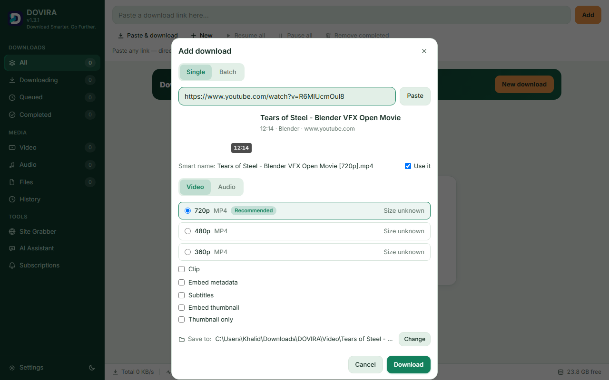
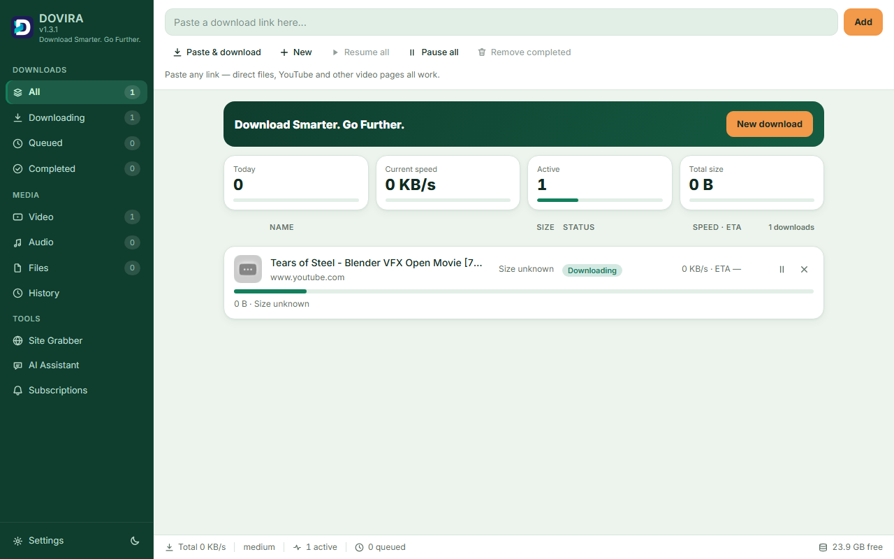
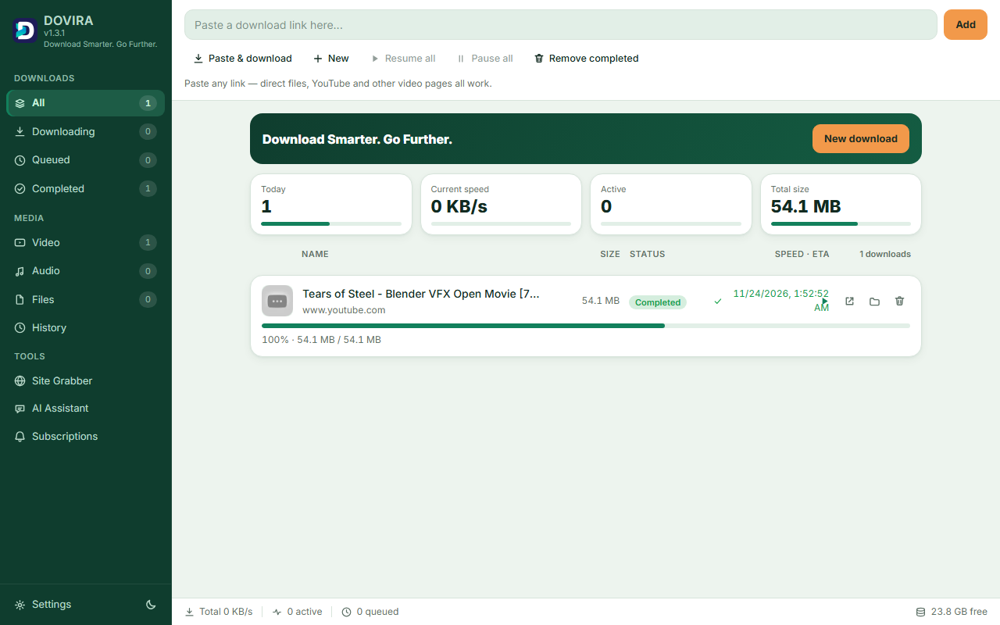
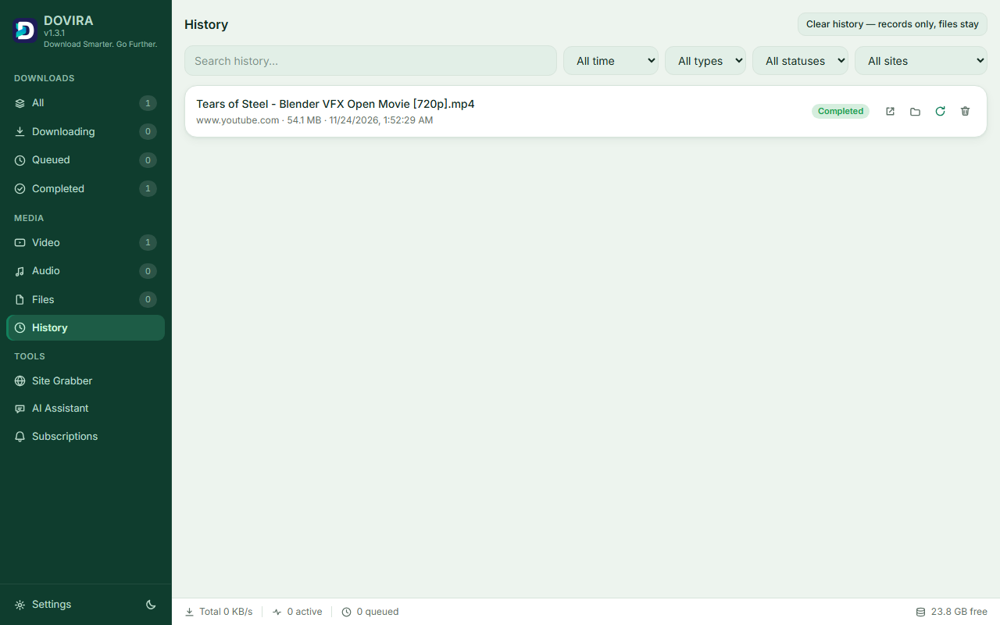
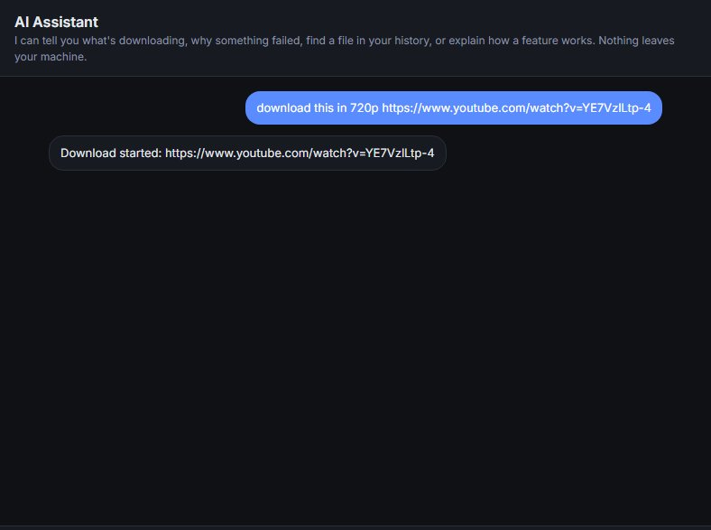

# DOVIRA

> **Download Smarter. Go Further.**

[](https://github.com/Khalid635/dovira/actions/workflows/build.yml)
[](https://github.com/Khalid635/dovira/releases)
[](LICENSE)
[](https://github.com/Khalid635/dovira/releases)
[](https://github.com/Khalid635/dovira/releases)

DOVIRA is a free, open-source AI download manager for Windows, macOS and Linux. Download videos and audio from the web with quality choice, smart resume, and rule-based smart features. **No ads, no tracking, no pro-lock** — and no account needed.

## Why DOVIRA

- **Free forever** — MIT licensed, every feature unlocked, no paid tier.
- **AI that actually helps** — Bangla commands, an AI Assistant, smart filenames, duplicate detection, and automatic file organizing.
- **Bangla + English** — the whole app speaks both.
- **Private by design** — everything runs on your machine; downloads, history and settings never leave it.

## Contents

- [Screenshots](#screenshots)
- [Quick start](#quick-start)
- [Install](#install)
- [Features](#features)
- [AI features](#ai-features)
- [Browser extension](#browser-extension)
- [Architecture](#architecture)
- [FAQ](#faq)
- [Limitations](#limitations-v143)
- [Contributing](#contributing)
- [Roadmap](#roadmap)
- [Build & run](#build--run)
- [Project structure](#project-structure)
- [License](#license)

## Status

**Current version: v1.4.3** (pre-release). Everything in the master plan through v1.4.3 is built and tested — see the [Releases page](https://github.com/Khalid635/dovira/releases) and [CHANGELOG.md](CHANGELOG.md). Highlights of v1.4.1: a separate progress window opens on every download start (filename, size, %, speed, ETA, Pause/Resume/Cancel), and the extension floating button now opens the Add dialog so you pick video quality or Audio (MP3) before downloading. In v1.4.2, clicking the floating button also brings the app window to the front, so the Add dialog with the quality/audio choice appears at once instead of staying behind the browser. In v1.4.3, the app starts with Windows automatically (always on, no toggle) and opens hidden to the tray, so the extension is ready without opening the app.

> All releases are pre-releases for now — a stable release is planned next (see [Roadmap](#roadmap)).

## Screenshots

| Home — Mint light theme | Add Download dialog | Home — dark theme |
| --- | --- | --- |
|  |  |  |

| Add dialog — real format list | Download in progress | Download completed | History |
| --- | --- | --- | --- |
|  |  |  |  |



All screenshots are real captures of the app (v1.3.1, Mint light theme unless noted). The four new light-theme shots were captured by driving the real app with Playwright — a real YouTube download of the CC-licensed "Tears of Steel" open movie (Blender Foundation). The AI Assistant shot is a real user-captured screenshot (dark theme).

## Quick start

1. **Install** DOVIRA from the [Releases page](https://github.com/Khalid635/dovira/releases) (Windows `.exe`, macOS `.dmg`, Linux `.AppImage` / `.deb`).
2. **First run:** the setup wizard walks you through the download folder, language (English / বাংলা) and the browser extension — in Bangla and English.
3. **Download:** paste a link, pick Video (up to 2160p) or Audio (MP3), and press Download. Or give the AI Assistant a link and a plain-language instruction — e.g. `এইটা ডাউনলোড করো`.
4. **Browser extension (optional):** load the extension from `extension/dist`, then pair it in 3 steps — reload the extension in your browser, open the app's Settings → Browser extension → **Pair extension**, and press Save on the page that opens. Details: [extension/README.md](extension/README.md).

## Install

Get the installer for your OS from the [Releases page](https://github.com/Khalid635/dovira/releases) (every release is a pre-release, with a SHA-256 checksum file — `checksums.txt` — next to the installers).

- **Windows:** `dovira-<version>-setup.exe` (NSIS installer).
- **macOS:** `dovira-<version>.dmg` (Intel x86_64; Apple Silicon runs it through Rosetta 2). The dmg is **unsigned** (no paid Apple Developer account), so Gatekeeper blocks the first launch: **right-click the app and choose Open** (or run `xattr -d com.apple.quarantine /Applications/dovira.app` in Terminal) — then it opens normally.
- **Linux:** `dovira-<version>.AppImage` (run it directly, `chmod +x` first) or `dovira_<version>_amd64.deb` (`sudo dpkg -i`).

**Auto-update:** the app checks GitHub Releases for a newer version (Settings > App updates; on by default, download is manual by default). Every downloaded update's SHA-256 is verified against the release's `checksums.txt` **before** it is installed — on a mismatch the update is cancelled, the old version keeps running, and Settings says why.

**aria2 on macOS/Linux:** aria2 publishes no prebuilt binary for these platforms, so it is built from source in CI (`scripts/build-aria2.sh`). If a release ships without it, plain files still download (through yt-dlp) — only torrents/magnets need aria2 and will report "engine missing".

## Features

- **Direct file downloads** — multi-connection via aria2, pause/resume that survives app restarts (network drop, app restart, PC reboot). yt-dlp resume always reuses the exact same format; if the partial file is gone, the app says so instead of silently restarting
- **Video & audio downloads** — YouTube and other video sites via yt-dlp: pick Video quality (up to 2160p) or Audio MP3, subtitles and thumbnail included on request
- **Smart Resume** — interrupted downloads resume where they stopped
- **Queue** — max 3 simultaneous downloads, the rest wait their turn
- **History** — every download is stored in local SQLite and survives restarts
- **Playlists & batch** — download a whole playlist/channel (pick the entries, one quality for all) or paste many links at once; already-downloaded videos can be skipped via the download archive
- **Clips, metadata & subtitles** — download just a time range of a video, embed title/artist metadata and thumbnails, or save subtitles as .srt (including auto-generated captions)
- **Torrents** — magnet links and .torrent files via aria2 (DHT on, never seeds after a download finishes)
- **Browser extension** — right-click "Download with DOVIRA", toolbar popup, floating download button on video pages, optional download intercept (off by default). Pairs with the app over a token-authenticated Local API on 127.0.0.1 — guided install, live status and diagnostics are in the app (Settings > Setup & diagnostics). See `extension/README.md` — Firefox (AMO) first; Chrome via Load unpacked. Do NOT submit the YouTube-download capability to the Chrome Web Store (its policy prohibits it). Local API reference: `docs/local-api.md`.
- **Site grabber** — scan a page for downloadable files (images, documents, media) and queue the ones you pick
- **Speed limiter** — a global cap plus a per-download cap, applied live to running downloads. A changed limit takes effect on the next _fresh_ yt-dlp download, not a resumed fragmented one (yt-dlp keeps the original throttle on resume); aria2 resumes apply the new limit immediately
- **Smart features (v1.0, Settings > Smart — every feature has its own switch)**
  - **AI File Organizer** — downloads are sorted into Video, Music, Documents, Archives, Programs, Images or Others, from the file extension, yt-dlp metadata (category, duration) and the source domain. Folder names are editable; extension overrides are yours to set
  - **Smart filenames** — strips `(Official Video)`, `[HD]`, emoji and extra spaces from titles, then applies your template (default `{title} [{height}p]`). The Add dialog shows a preview with a one-click revert
  - **Duplicate Detection** — checks the history for the same URL or the same video + format, and the destination folder for the same name + size. If found, the dialog offers Re-download / Skip / Keep both
  - **Smart Download** — measures your running speed and adapts: more aria2 connections and yt-dlp fragments when fast and stable, fewer (and longer retry gaps) when slow or unstable
  - **Local AI model (optional, off by default)** — for the downloads the rules cannot categorize, an Ollama or LM Studio model running on your machine can be asked instead. No model is bundled; nothing leaves your machine

Engines: aria2, yt-dlp, ffmpeg and Deno (all bundled).

## AI features

### AI Assistant (v1.1.0)

- **Chat panel in the app** (English + বাংলা). Give it a link and a plain-language instruction — e.g. paste a YouTube link and write `এইটা ডাউনলোড করো` — and it starts the download.
- **Rule-based first**, so it works with no setup, no API key and no cost. An optional local model (Ollama / LM Studio) can be switched on for the cases the rules cannot handle; nothing leaves your machine.
- **Plain-language help** — when a download fails, it explains the reason in plain language and suggests what to try next.

### Smart downloads

The Smart features above are the AI side of every download: files get organized into folders, titles get cleaned up, duplicates get caught before they waste your bandwidth, and the downloader adapts its connections to your real speed. All of it is rule-based and runs locally — the optional local model only steps in for the cases the rules cannot categorize.

## Browser extension

- **Manifest V3 extension** — right-click "Download with DOVIRA", toolbar popup, floating Download button on video pages, optional download intercept (off by default).
- **Pairs with the app** over a token-authenticated Local API on 127.0.0.1 (default port 17530). Guided install, live status and diagnostics are in the app (Settings > Setup & diagnostics).
- **Install:** load the built extension from `extension/dist` — Firefox (AMO) first; Chrome via Load unpacked (Developer mode). See [extension/README.md](extension/README.md) and the [Local API reference](docs/local-api.md).

## Architecture



How the pieces fit together in v1.3.1: the browser extension talks to the app over a token-authenticated Local API on 127.0.0.1 (default port 17530); the Electron main process runs the download queue and asks its bundled engines to do the work — yt-dlp for fetching info and formats, aria2 for the actual download, and ffmpeg for merging and MP3 conversion (Deno is also bundled). Downloads are recorded in SQLite. The AI Assistant is rule-based and runs on-device — no data leaves the machine. `fetchInfo` takes around 10 seconds; that is normal extraction, not a hang.

The interactive version is [docs/diagrams/architecture.html](docs/diagrams/architecture.html).

## FAQ

**Is DOVIRA really free?**
Yes. MIT licensed, no ads, no tracking, no account, no pro-lock. Every feature is unlocked.

**Can it download YouTube videos?**
Yes — via yt-dlp, with Video quality up to 2160p or Audio MP3, plus subtitles and thumbnails on request. The quality list shows only the formats the site really offers for that video.

**Why does fetching a video take ~10 seconds?**
yt-dlp has to extract the video's format list — that takes 9–13 seconds and is normal. Results are cached for 5 minutes, so clicking the same video again is instant.

**Is my data sent anywhere?**
No. Downloads, history and settings stay on your machine. The AI Assistant is rule-based by default, and the optional local model also runs on your machine.

**Why does the extension need Developer mode in Chrome?**
The Chrome Web Store prohibits YouTube-download extensions, so DOVIRA's extension is installed unpacked (Developer mode). Firefox users can install it from AMO when the listing is ready.

**Why is the macOS dmg unsigned?**
There is no paid Apple Developer account. On first launch, right-click the app and choose Open (or run `xattr -d com.apple.quarantine /Applications/dovira.app`).

**Why is there no 1080p for this video?**
The quality list comes from the site's real format list. If a video has no 1080p, 1080p is not offered — DOVIRA never invents a quality.

**Does it support DRM sites like Netflix?**
No — and no app can. See [Limitations](#limitations-v143).

## Limitations (v1.4.3)

- ~~Clicking the extension floating button could leave the Add dialog hidden behind the browser~~ — fixed in v1.4.2: the app window now comes to the front when the dialog opens.
- Login-only videos need cookies — set them in Settings > Browser & Cookies (the app says so instead of failing silently).
- DRM-protected sites (Netflix, Prime Video, Disney+) can never be supported.
- The browser extension UI is English-only for now; the app itself is EN/BN.
- Playlist links sent from the extension are refused — pick entries in the app's Add dialog.
- Video quality shown comes only from the site's real format list — if a video has no 1080p, 1080p is not offered.
- The macOS dmg is unsigned — first launch needs right-click > Open (see Install).
- On macOS/Linux without a bundled aria2, torrents/magnets are unavailable (plain files still work via yt-dlp).
- A changed speed limit or fragment count takes effect on the next _fresh_ yt-dlp download, not on a resumed fragmented one (see Speed limiter above).
- The "Total size" stat counts the video stream size yt-dlp reports, which can differ from the final file size on disk.

## Contributing

Bug reports and feature requests: [open an issue](https://github.com/Khalid635/dovira/issues) — templates for bug reports and feature requests are ready, just fill them in. Never paste tokens, passwords or cookies in an issue.

Pull requests are welcome. Please run `npm test` and `npm run build` before submitting. Tests live in `tests/` — 369 tests across 70 suites, all passing (`npm test`).

## Roadmap

- **Stable release** — the next release, once the current version is verified end-to-end (extension pairing + clean install).
- **Official website + landing page** — real screenshots and the demo video in one place.
- **Firefox AMO listing** and a winget package.

## Build & run

```bash
npm install
npm run fetch-binaries   # downloads aria2, yt-dlp, ffmpeg, deno into resources/bin/win (git-ignored)
npm run fetch-binaries -- --platform mac    # macOS binaries (yt-dlp, ffmpeg, deno; aria2 needs scripts/build-aria2.sh)
npm run fetch-binaries -- --platform linux  # Linux binaries (same note)
npm run dev              # dev shell (Electron + Vite)
npm run build            # extension build + typecheck + production build
npm run build:extension  # browser extension only (TypeScript -> extension/dist)
npm run build:win        # Windows installer (NSIS)
npm run build:mac        # macOS dmg (unsigned — needs a Mac or GitHub Actions)
npm run build:linux      # Linux AppImage + deb (needs Linux or GitHub Actions)
```

Engine binaries live in `resources/bin/<win|mac|linux>/` and are **not** committed — a fresh clone runs `npm run fetch-binaries` to get them (pinned versions, verified on install).

> If `npm run dev` fails with `Error: Electron uninstall`, the Electron binary
> didn't download during install — run `node node_modules/electron/install.js`
> once, then try again.

## Project structure

```
src/main/         Electron main: queue, db, settings, ipc, localApi (extension Local API), updater (auto-update), checksum (SHA-256 verification)
  engines/        aria2.ts (JSON-RPC), ytdlp.ts, versions.ts
  smart/          categorize.ts, naming.ts, duplicates.ts, adaptive.ts, localModel.ts (rule-based; local model optional)
  util/           filename.ts, errors.ts, paths.ts
src/preload/      contextBridge API (window.dovira)
src/renderer/     React UI: Home, DownloadCard, Settings, AddDownloadDialog, EN/BN i18n
extension/        browser extension (Manifest V3): background, content script, popup, options
resources/bin/    engine binaries (git-ignored)
scripts/          fetch-binaries.cjs, build-extension.cjs, build-aria2.sh
docs/             phase test reports, benchmark.md, screenshots/, local-api.md (Local API reference)
```

## DRM note

DRM-protected sites (Netflix, Prime Video, Disney+) are **not** supported — no app can download from them, and DOVIRA never tries to break DRM. Users are responsible for following each site's terms and copyright law.

## Torrent note

Torrents are supported only for legal content — e.g. Linux ISOs and public-domain media. DOVIRA never seeds after a download finishes (seed-time 0).

## License

MIT — see LICENSE. Third-party notices: THIRD_PARTY_NOTICES.md.
